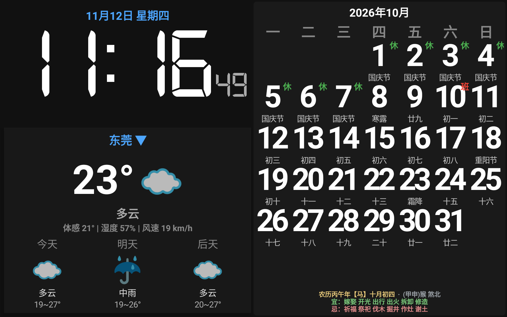

# 台历时钟 CalendarDesk

闲置手机 / 平板改造的**全屏桌面台历**：大字号时钟 + 实时天气 + 农历万年历，横屏常亮，适合放在桌边、床头当电子台历。



## 功能特性

- **网络校时（NTP）**：NTP 协议（UDP 123）多源投票校准，正常网络下误差在几十毫秒级；网络封禁 UDP 时自动降级为 HTTP 校时。
- **实时天气 + 3 日预报**：和风天气 API，支持**全国任意城市 / 区县**（内置 3393 条行政区划库，打字即时联想）。
- **农历万年历**：农历干支、生肖、宜忌、冲煞；法定节假日「休 / 班」角标（含调休补班）。
- **月份浏览**：日历左右两侧 ◀ / ▶ 翻阅前后月份，30 秒无操作自动回到本月。
- **全屏沉浸 + 屏幕常亮**：触摸屏幕唤出浮动按钮，5 秒无操作自动隐藏。
- 手动时间微调、日历浏览、API Key 设置等。

## 天气 API Key 申请（免费）

应用默认**不带 Key**，需自行免费申请和风天气 Key：

1. 打开 <https://dev.qweather.com/> 注册账号并登录。
2. 进入【控制台】→【项目管理】。
3. 点击「创建项目」，填写项目名称。
4. 选择【免费订阅】，设置 KEY，选择【Web API】，填写名称，点击创建。
5. 创建成功后，在项目管理中查看 **Private KEY** 并复制。
6. 打开应用，点击**左上角金色钥匙 🔑**，填入 Key 保存。

> 没有 Key 将无法获取天气信息（时钟、日历功能不受影响）。

## 使用方法

- **切换城市**：点击天气区城市名右侧的蓝色 ▼，输入城市名（如「深圳 / 南山 / 东莞」），点击联想结果即可。
- **重校时间**：点击左上角 ↻。
- **浏览月份**：触摸屏幕唤出按钮，点日历左右两侧 ◀ / ▶。
- **微调时间**：设置页内可 ±1 秒微调、重置偏移。

## 构建

环境：Android Studio / Android SDK（compileSdk 34，minSdk 23，AGP 7.2.2）。

```bash
# Windows
gradlew.bat assembleRelease
```

> 说明：为方便个人分发，release 构建默认使用**调试签名**（可直接安装）。如需上架应用市场，请在 `app/build.gradle` 的 `signingConfigs` 中替换为你自己的 release keystore。

## 技术栈

Java · OkHttp · Gson · cn.6tail:lunar（农历）· ThreeTenABP · AndroidX

## 许可证

[MIT](LICENSE)
